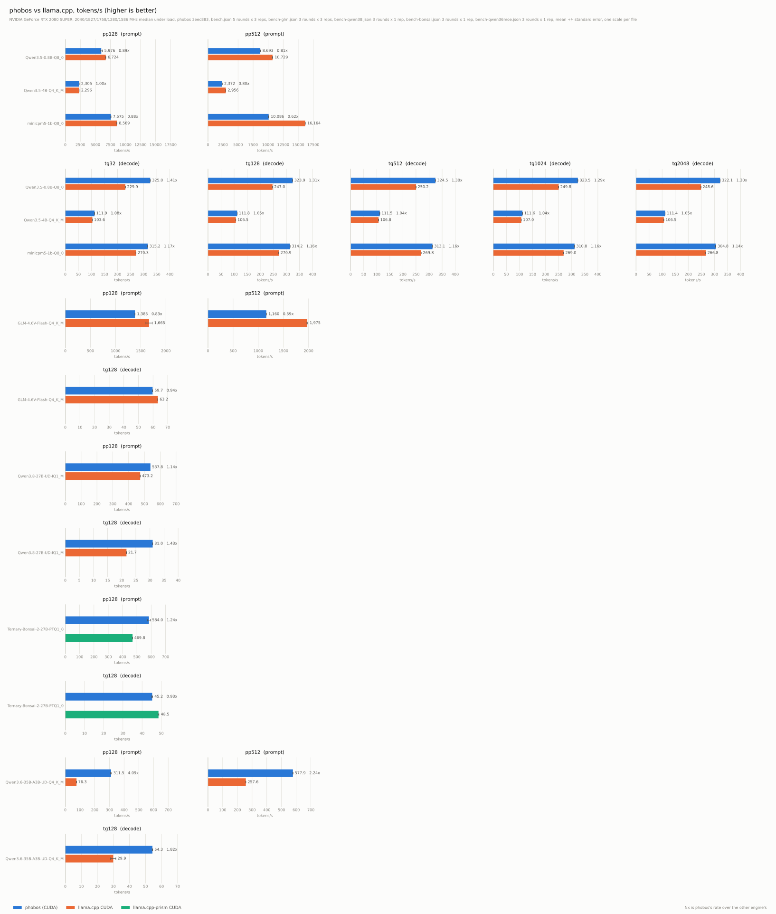
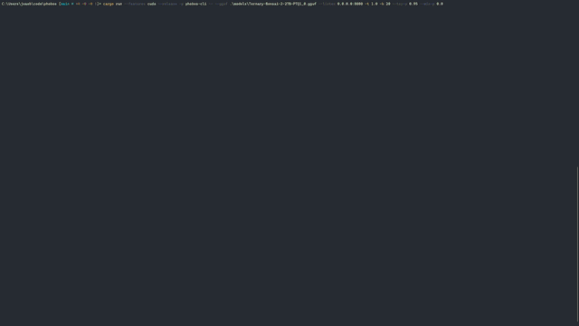

> **TLDR:** Phobos, the tiny kernel language from my last post[^1], now runs LLMs. A GGUF file goes in, tokens come out, and every kernel in between is compiled at runtime from Phobos. No cuBLAS, no CUDA toolkit, just the driver. On my old RTX 2080 SUPER it generates text as fast as llama.cpp or faster on every model I tried but one: 328 against 260 tokens a second on a 0.8B model, and 55 against 31 on a 35B mixture of experts that doesn't even fit on the card, with llama.cpp at its best settings. The one is a ternary 27B, where PrismML's newest llama.cpp fork now decodes 8% faster than Phobos (49 against 45), though Phobos still reads prompts 1.27 times faster. When the desktop takes 2 GiB away mid-session, Phobos keeps three quarters of its decode speed and llama.cpp keeps 30%. Prompt processing on the small models still loses, at 60 to 80% of llama.cpp. Oh, and there's a first release now.

---

## Phobos v0.1.0

I'm happy to announce that I've created the very first release of Phobos, which has grown from a learning exercise into an LLM inference stack. It is still a learning exercise for me.

Context: I happen to have an RTX 2080 SUPER in my workstation. That's a card from 2019, with 8 GB of VRAM. Not very fancy. It gets the job done. Modern inference frameworks mostly ignore such old cards[^15], or care less about heavy quantization. So it's a slow card to begin with, and I assume the kernels have not been tuned for it.

Phobos does very well with quantizations in the 1-bit realm. It runs PrismML's Ternary-Bonsai-2-27B, too, and was faster than their own llama.cpp fork until their latest build. Of course, only measured on my card.

You can grab your copy of Phobos on [GitHub](https://github.com/joa/phobos-lang/releases).

This post is a story about moving from a compiler to an inference engine. Chasing (the wrong) benchmarks and optimizing your own JIT-compiled kernels. Phobos inference runs entirely on Phobos kernels that are compiled at runtime.

## The Curse of Curiosity

My last post[^1] ended with "now I am really going to stop". Well. Kind of. You see, when I hit 76% of cuBLAS for SGEMM I did not see the point in trying to chase more performance. I had reached the point of diminishing returns. When I started, I wanted to learn more about AI, and especially the GPU side. But I had exhausted what my card's ISA offers. There are cool tricks you could do on newer GPUs, but in the end, this was really it for me.

So I picked a different target. I implemented FlashAttention[^2] in Phobos, then FlashAttention-2's tweaks to the online softmax[^3]. Once that worked, I implemented Kimi Delta Attention[^4]. 
Of course I benchmarked the kernels. However I did not know if the implementation was any good. But with the attention kernels at my disposal, how hard could it be to run a complete LLM?

So I set myself two goals:

1. Run a complete LLM end-to-end using the Phobos language and compiler
2. Achieve 80% of llama.cpp<ext-link href="https://github.com/ggml-org/llama.cpp"></ext-link> performance

If you remember the last post:

**GGUF file ⟶ Tokenizer ⟶ Forward pass ⟶ <span style="color: #383">Kernels ⟶ MLIR ⟶ PTX ⟶ GPU</span> ⟶ Sampler ⟶ Text**

The middle of that chain was the last post. This one is about everything around it.

<details>
  <summary><strong>Side-quest:</strong> GGUF, not ONNX</summary>

I started with ONNX, because it ships a complete graph. It made sense to me. However, I did not continue down that road. That graph needs a lot of optimization before it performs decently. And the most important reason: I need to run quantized models, and if you look at Hugging Face, chances are quite high you'll find a GGUF[^5] version, but nobody cares about ONNX nowadays.

GGUF is easier to deal with. It's some metadata, a chat template and, of course, the tensors, but the computation is implied. That is: the GGUF file specifies "hey, I'm a `llama` family model" and you have to know what to do with that information. In theory, ONNX is superior. In practice, the simple solution wins. 

GGUF also provides a tokenizer (absent for ONNX) and a forward pass is a couple hundred lines of Rust.

</details>

## The Oracle

The first model I downloaded was Qwen3.5-0.8B at Q8_0. No particular reason. I just thought it was small enough for my 8 GB card. The big downer was that most of this model's blocks are Gated DeltaNet[^4] linear attention, which carries a recurrent state instead of a growing KV cache.

After building the kernels and a reference oracle on the CPU side (at a whopping 4.5 tok/s), the oracle produced tokens that looked correct but made no sense and degenerated.

Luckily, I could peek at llama.cpp's `qwen35.cpp`. There were a couple of bugs, but the most prominent was a missing (implicit) 1/√d scale on the queries that screwed up the DeltaNet blocks.

Once that was solved, the Phobos oracle and llama.cpp picked the same tokens on most prompts, and on the others, the top candidates were ~0.03 logits apart (within noise). That was good enough for me to call it my baseline.

## Whole-Model Bugs

Moving to the GPU made things slower. What a wonderful start.

Two issues took me a good amount of time. The first was that reusing allocated memory corrupted the model. The second was that prompts longer than a single token started to degenerate from the first block on. 
When I checked every operation on its own, everything produced the right values. 

It was the same bug though. Kernels were writing past the end of their outputs. When the last tile of a kernel was running past the end of the tensor, the compiler simply did not have any machinery to handle this. I took a lot of shortcuts when writing the initial version of the compiler. This was one of them. A five-row prompt wrote 27 additional rows past its output. But since the check only looked at the expected output, the first five rows, everything _looked_ correct. Whatever came next in memory was broken. When using `cudaMalloc` every time, this didn't happen.

<figure class="bp-figure">
{}
  <figcaption><p>A five-row output still gets a full 32-row tile, and without a mask the other 27 write garbage. The check only reads its own five rows, so it passes either way.</p></figcaption>
</figure>

The fix went into the compiler: proper masking (plus `@aligned` for kernels whose callers can make a promise on the shape). The uncomfortable lesson for me was that I always had to run (slow) whole-model checks. Testing in isolation was simply not good enough. 

MiniCPM5-1B uses the plain `llama` architecture and hit another subtle bug. It was barely any new code. I was able to decode fine up to about 512 tokens, but then it collapsed into noise. 512 is where the rotary table and the KV cache both grow. Their sizes matched _exactly_:

```plain
2 kv heads x 128 dims x 512 positions = 131072 floats
1024 positions x 128 rope dims        = 131072 floats
```

The new rotary table got the old KV cache's freshly released buffer, and the copy that was supposed to carry the cache forward got rotary angles instead. Qwen never hit it, purely because its two sizes differ by a factor of eight. MiniCPM revealed a couple more bugs. At one point token generation never stopped. MiniCPM's end token is `</s>` while its chat template ends every turn with `<|im_end|>`. 

## Fast Decode

Decode (or token generation) and prompt processing (or prefill) are very different problems. The math for decode is actually quite simple though. 

To produce one token, a decode step must read every weight in the model once and then do one multiply and one add per weight. That is approximately 2 operations for every byte we load from memory.

My GPU can do about 11 TFLOP/s. Memory bandwidth was measured at 400 GB/s. 11 trillion ops/s divided by 400 billion bytes/s is **27.5**. The advertised speeds of the card are a bit different and would yield you **22.5**. For the purpose of this blog post we take the middle: **25** operations per byte is what you need to keep the math units of the GPU busy. But we use only 2 operations per byte. Ergo the math units spend most of the time waiting for fresh data. This is why people say decode is memory-bound.

The ceiling for token generation is easy to compute, too. If you have a model, like our friend Qwen3.5-0.8B, that reads 0.83 GB per token, you can compute `0.83 GB / 400 GB/s`, and that's about 2ms, or 500 tokens a second. This is our physical limit. Phobos is at 328 tokens a second today.

Prompt processing is the opposite. For 512 tokens, you reuse every weight 512 times. This is math-heavy stuff where you want to saturate the tensor cores. Let's look at decode first.

<figure class="bp-figure">
{}
  <figcaption><p>Decoding pushes every weight across the memory bus once per token and does almost no math with it, so the bus sets the pace and the math units mostly wait. A prompt reuses each weight for all 512 tokens, and the bottleneck flips.</p></figcaption>
</figure>

The first obvious step was to keep the weights quantized. I initially expanded them to `f32` at load time. Keeping them quantized cut the memory by almost three quarters and bought me... nothing. The kernel still expanded every block back to `f32` in shared memory before multiplying, so it never got anywhere near the bandwidth limit. But doing the math end to end in `int8` using `dp4a` achieved the desired result. Performance jumped by 30%. Since far less shared memory is required, more blocks fit on the GPU at once. 

Another big one was thread mapping. A Q8_0 block carries its own scale. The kernel had to stop every 32 elements to apply it, one thread per output with most of the thread block idle. The fix was a new intrinsic, `qdot_t`, which does the whole multiply-and-add for a row including the scales. Now a warp owns one output and splits the work across its 32 lanes, with no shared memory and a single shuffle at the end. Decode got two to seven times faster for several kernels, 1.4x total.

<figure class="bp-figure">
{}
  <figcaption><p>Decoding is a matrix times a vector. Before, every thread walked its own row and stopped every 32 weights for that block's scale. With <code>qdot_t</code> a whole warp reads one row in contiguous 512-byte stretches, every lane multiplies its own partial sum by its block's scale right in a register, and a single shuffle adds up the lanes.</p></figcaption>
</figure>

After that came some well-known launch optimizations. For example, a complete pass can be recorded and replayed as a CUDA graph[^6]. Then came fewer and fatter kernels: quantize an activation once and share it, stack projections that read the same input, fold the residual add into the matmul.

| Qwen3.5-0.8B, decode                     | tokens/s |
| ---------------------------------------- | -------: |
| starting point                           | 76       |
| `qdot_t`, the fused quantized dot        | 106      |
| replay the pass as one CUDA graph        | 170      |
| stop allocating while recording (it did 5000 allocations a step) | 191 |
| a dozen small fusions                    | 260      |
| today: a newer driver, plus everything that follows in this post | 328 |

## Opening the Floodgates

While working on Phobos, I read Sankalp's write-up on auto-research<ext-link href="https://sankalp.bearblog.dev/autoresearch/"></ext-link>, the loop Karpathy popularized<ext-link href="https://github.com/karpathy/autoresearch"></ext-link>: an agent changes the code, measures, keeps or discards the change, and repeats. I really liked the idea of keeping a _beam_ of three or more ideas alive at once, writing down the hypothesis, what it changed and what to try next. 

I copied the prompt, adjusted it a little and let Claude go wild. I ran it overnight, since it needed my GPU and the precious VRAM the desktop otherwise occupies. 

What it found in about two sessions:

- **Decode attention was using 32 of its 256 threads.** Seven warps sat there watching the eighth one work. A new builtin, `warp_partial`, spreads the loop over all eight, and the kernel's time dropped by more than half.
- **Using FlashAttention.** A trace said attention was responsible for about 37.5% of a whole pass, and the model wasn't even using the FlashAttention kernel I had built at the very start. Switching to it was a lot faster.
- **Vectorizing attention.** The main prompt attention kernel had no `@aligned` on it. The profiler was printing "estimated speedup: 36%". With the addition of two attributes it was almost twice as fast.
- **The megakernel was a dead end.** The idea is one kernel for the whole decode step. But launch overhead did not shrink at all. At that point, I was already using CUDA graphs, and the published megakernels win by removing the bubbles between kernels, not the launches[^12]. I still think there's something to this, like more potential for optimization, but for now I will focus elsewhere. The fuse pass is still a result of this work. 

<figure class="bp-figure">
{}
  <figcaption><p>A block has eight warps, and the decode attention loop only ever ran on one of them. <code>warp_partial</code> gives each warp its own slice of the keys and merges the results at the end. Only the loop gets eight times the hands, which is why the kernel's time dropped by more than half and not by 8x.</p></figcaption>
</figure>

<details>
  <summary>Agents producing confident, wrong data</summary>

- **Two benchmarks running at once silently corrupt each other.** Both engines read at half speed in every round, including the rounds the harness had labeled "uncontended", because it only checked the card _between_ rounds. I changed the Claude prompt to always check absolute numbers against a known baseline.
- **Two trees sharing one Cargo target directory race each other**, and you get random failures with zero conflicting changes.
- **An agent can do real, correct work and never report back.** This happened to me many times. So now, after three resume-and-wait cycles, the coordinator takes over: read the diff, re-run the checks, re-run the benchmark.

</details>

## More Quantizations

So now Phobos beats llama.cpp on Q8_0 thanks to the magic of autoresearch. Nobody runs Q8_0 though. People run Q4_K_M, and below that there's a whole zoo of 1-, 2- and 3-bit formats, and the smallest of them let a 27B model fit on a card like mine. So I wanted to support more formats.

The CPU decoders came first, written straight off `ggml-quants.c`[^8], along with a tool to verify correctness. `quant_check` compares a quantized file against a higher-precision copy of the same model, tensor by tensor. Since I learned that a wrong decoder still generates fluent text, this is the only reliable way I found to catch errors.

The target for me was to support Qwen3.8-27B in Unsloth's IQ1_M quant. That's about two bits per weight. 6.27 GiB of weights on an 8 GiB card (that also drives my desktop). llama.cpp managed about 22 tokens a second. Phobos, on day one, took 11 seconds to read a 128-token prompt and then generated somewhere between 0.6 and 2.4 tokens a second, depending on its mood. ...yey :)

### GPU Performance Heisenbugs

Heisenbugs disappear when you try to look at them. Read my [post from 2015](/posts/2015-04-13-hunting-a-javascript-heisenbug/) for a story about V8 on that matter. 

0.6 tokens per second is ridiculously slow and about 37x slower than what llama.cpp was doing. The profiler was showing that the output head ran at 1.1% of the card's bandwidth when reading a 521 MiB tensor once per token. With the help of Claude, I attacked it, to no avail. Different tile widths, hand-hoisted index math, remapped lanes for wider loads. Nada.

In theory, the kernel should take about 3.6ms bounded by instruction issuing. But it took 96.7ms instead. The kernel was 27x slower than its estimated worst case. When I then ran the kernel in isolation to check what was going on, it took 3.2ms. 

The output head was being paged in from system memory via PCIe for every single token[^14]. `nvidia-smi` reported it as resident and the GPU as 100% busy, which is why I did not look. The reason is that an evicted/paged allocation still counts as "used" and a kernel waiting on the bus is shown as "busy". This was super confusing to me and I spent a good amount of time and tokens on this problem. Furthermore, the issue disappeared in isolation because the rest of the weights weren't loaded. Or because I happened to have fewer desktop apps open, and more VRAM was free.

<figure class="bp-figure">
{}
  <figcaption><p>Everything the 27B needs on an 8 GiB card, plus whatever the desktop is using. Drag the desktop up: Windows doesn't fail anything, it quietly moves an allocation to system RAM and pulls it back over PCIe every time a kernel touches it, while <code>nvidia-smi</code> keeps saying the memory is used and the GPU is busy.</p></figcaption>
</figure>

Once I knew the problem, I started working on memory management. The Windows display driver manages memory residency per allocation. If you have hundreds of small allocations, chances are they get paged out before a couple big ones. Phobos is now using a fat slab allocator instead. Furthermore, prefill left a 542 MiB slab in the memory pool that decode could not use (more on that later). After those changes, speed only depended on how much VRAM the desktop was using. Decode went from 0.6 tokens per second to roughly 18. When the desktop took more VRAM, tokens per second dropped, but that is expected, and the same happened with llama.cpp on my machine.

> Fun fact: I learned about a lot of applications on my desktop machine I didn't know existed. Some Xbox game overlay I don't recall ever installing was 
> eating a lot of VRAM (a lot as in: relative to how much I have I guess :>). The stupid widgets panel I don't use. 
> And then there are the pesky Electron apps. However, I'd really like to understand where the other ~800 MiB go. When I close all my apps and just the idle desktop is open,
> I can never get the desktop below 910 MiB of VRAM, and about 100 MiB of that is what I'd expect for a desktop at native 4K. How much was actually active on the card or paged out, I don't know.

Once memory was under control, the focus shifted back to the kernels. The IQ formats decode into exact int8 values, so prompts run them straight on the integer tensor cores, and storing the weights in groups of eight columns lets a decode warp read whole cache lines. Where it stands today:

| Qwen3.8-27B-UD-IQ1_M | Phobos | llama.cpp |
| --- | ---: | ---: |
| prompt, 128 tokens | 532.6 | 477.0 |
| decode, 128 tokens | 31.4 | 22.0 |

That's 43% faster at token generation and also the very first time prompt processing was faster.

But: I did not spend any time optimizing for the case where the desktop grabs too much VRAM. Once the model no longer fits onto the card, the driver pages it via PCIe and it drops to something like 7 tokens a second. But ultimately I am now able to run Qwen3.8-27B-UD-IQ1_M on a consumer card at a decent speed.

### PrismML Ternary-Bonsai-2-27B

PrismML released Ternary-Bonsai-2-27B just in time. Of course, I wanted to see if I could run this model, and at what speed. I also got curious because so far, I hadn't really been a fan of 1.x-bit quants. Ternary-Bonsai-2-27B uses ternary weights (-1, 0 or +1). The `PTQ1_0` format packs 128 weights in 28 bytes and on top of that it uses a Hadamard matrix transform, rotating the activation. It spreads outliers over the whole block, so quantization is supposed to lose a lot less[^11]. At the time of writing, stock llama.cpp can't run this model, but PrismML's fork can[^9]. 

Since I had hill-climbed on 1-bit formats early on, I had high hopes. The first working version was ahead from the start, at 34 tokens a second against the fork's 29. One trick: the rotated activation can be computed once and shared by every projection that reads the same input.

PrismML's latest build (b10754) does that too, and it shows: it decodes at 48.8 tokens a second against Phobos's 45.2. Phobos still processes prompts 1.27 times faster.

<figure class="bp-figure">
{}
  <figcaption><p>Ternary weights share one scale per block, so a single outlier can ruin it: the best scale fits the outlier and every small weight rounds to zero. A Hadamard rotation, random sign flips followed by stages of adds and subtracts, spreads the outlier over the whole block, so rounding loses a lot less. The activations get the same rotation at runtime, so the product doesn't change, and one rotation serves every projection that reads the same input.</p></figcaption>
</figure>

Then several "human errors" needed to be removed. Every kernel launch was reading an environment variable. `std::env::var` searches the whole environment, under a global lock, on every call, and the card sat idle for about 2ms between tokens. Guess where that time went. Then the CUDA graph was patched far more than necessary. The buffer pool handed out buffers in no particular order, so most of the graph's nodes (>1000) were repatched every step, when only 80 actually needed a new address. The buffer pool is now address-ordered, so every step gets the same buffers back and only those 80 nodes need patching. This alone was a 5% improvement. 

| Ternary-Bonsai-2-27B-PTQ1_0 | Phobos | llama.cpp (PrismML fork) |
| --- | ---: | ---: |
| prompt, 128 tokens | 599.1 | 472.4 |
| decode, 128 tokens | 45.2 | 48.8 |

## Q4_K_M

With enough understanding and most of the early issues resolved, it was time to see where performance really stood. Q4_K_M is where llama.cpp is at its best. It's not someone else's fork.
This format is what most people who use llama.cpp actually run. Their kernels are bandwidth-bound, so there's really nowhere to hide.

At llama.cpp's speed on Qwen3.5-4B, a token takes 9.2ms. Around 2ms of that goes to launching kernels before a single weight byte moves. That leaves about 7ms to read 2.7 GB, which already runs at roughly 90% of my card's plain memory-copy bandwidth.

So parity needed kernels faster than anything I had _and_ no more launches than llama.cpp.

I wrote these goals down and started the autoresearch loop. These were the hard facts that Claude had to optimize for.

At some point, I had to introduce a compiler cache: the sheer number of kernels compiled to PTX made a cold start take about 20min. The cache is keyed on each kernel's Phobos source and the hash of the compiler (and its dependencies). The inner loop checked kernels against the CPU oracle and used small runs, with the whole-model checks as the gate, and left the full benchmark suite (another hour) for the end. This paid off: the very first time the full suite ran, decode was already at 85% of llama.cpp's speed.

Fusing the whole multilayer perceptron (MLP) into one persistent kernel provided a 6% boost. Some leftovers also ate speed. There was a fast norm kernel, but only for a model width that's a multiple of 1024, and this model is 2560 wide. Generalizing it gave another 4.5%, and using it inside the already fused kernels another 4.2%. 

| Qwen3.5-4B-Q4_K_M | Phobos | llama.cpp |
| --- | ---: | ---: |
| prompt, 128 tokens | 2308 | 2318 |
| prompt, 512 tokens | 2353 | 2957 |
| decode, 128 tokens | 113.3 | 110.1 |

This is now parity on llama.cpp's best format for decode. Longer prompts are still losing.

## Graph IR

I always suspected that my compiler produced less optimal MLIR, which in turn produced less optimal LLVM IR, which in turn produced less optimal PTX. I thought the main issue was my codegen being a simple AST walk that generated MLIR as it descended the tree. There was no liveness information, no dominance frontiers. Which meant, for example, more memory barriers than necessary. 

So the logical move was to lower the AST into an SSA graph IR first and run passes over it before emitting MLIR. The more I used MLIR through the Rust `melior` crate, the less I wanted to build my own dialect. For a handful of passes, a plain graph IR is enough, and a dialect would have been overkill. Now, one pass places shared memory by liveness analysis. Another pass can insert a barrier where the access actually conflicts. Triton does something similar[^10].

Across all 724 kernels, the number of memory barriers went from 1092 to 888, and 84 kernels now need less shared memory. It didn't move the benchmarks, though, which surprised me. But it eliminated a lot of special cases and very ugly machinery (`let`-bound tiles never released their memory in the AST codegen), and it's a foundation for more compiler work. That said, I'd rather understand first where the 20min of a cold compile really go before making it even slower :) 

> The slowest kernel spends 5min in LLVM's NVPTX backend. I'll still have to see how I can speed that up. I also want to experiment with `libNVVM`, although for `sm_75` (my card) it only accepts the old LLVM 7 dialect of NVVM IR; the modern one is Blackwell-only. In theory `libNVVM`
> is supposed to produce better PTX, and if I get another perf boost for free I'll take it. 

## Mixture of Experts

So far all the models fit (barely) on my card. Qwen3.6-35B-A3B doesn't, but it's a mixture-of-experts model. I was aware of all the cool "streaming MoE" posts[^13], so I wanted to see what's possible.

Each of Qwen3.6-35B-A3B's 40 layers has 256 small feed-forward networks, the experts, and a router picks eight of them per token. The experts are 19.5 GB. With only 8 GB (in theory), I would have to stream them if I ever wanted to run this model. Another 2 GB of the model has to stay resident on the card. That's everything that isn't a routed expert: the attention and DeltaNet layers, the routers, the shared expert and the output head. Every token needs all of it, so there's no hit rate to play with, and streaming it would push 2 GB over my PCIe bus, which moves about 6.4 GB/s, for every single token. That's about 0.3 seconds per token before any math happens. So both Phobos and llama.cpp keep it on the GPU. But for the experts, the two decide very differently. 

For llama.cpp you decide at load time with `-ncmoe N` how many layers keep their experts on the CPU. Finding `N` is your problem (or done via `--fit`, which is the default). Sometimes people on the web share their llama.cpp invocation for max performance. If you were to copy that, make sure you have the exact same hardware. So I wrote a script to find the best combination of parameters, and it spat out `-ncmoe 31 -t 8`. With only 29 layers' experts on the CPU, the GPU started paging, and we already learned how bad that is.

I don't like this. I want my software to do the work for me. I know that some people like explicit switches. You look for a configuration and you think you have predictable performance, but that is only true as long as your environment is fully predictable. A desktop that sometimes takes 900 MiB, and then 1.5 GiB, is not really predictable for me. This is why Phobos uses a different design.

I keep a cache of experts on the GPU. Because expert picks repeat a lot within a task, about 80% of them hit the cache. But what happens on a miss? Well, the expert is either copied via PCIe to the card (evicting another one, unless there's room) or computed on the CPU. Since my card is sitting on a PCIe 3.0 x8 bus, every copy really hurts.

<figure class="bp-figure">
{}
  <figcaption><p>One layer of Qwen3.6-35B-A3B: 256 experts, eight per token, and only a cache of them fits on the card. Most picks are already there; the rest cross the PCIe bus or get computed by the CPU straight from system RAM. The routing is simulated and tuned to the roughly 80% hit rate the real model gets.</p></figcaption>
</figure>

This is also why my initial idea didn't work out. Lookahead prefetch. The idea is to run the next layer's router early, then guess its experts and copy them over while the current layer is still computing. The guess was also about 80% correct and the cache hit rate went up. But decode went down from 32 to 25 tokens per second. With a bus that slow, you simply pay too much for a wrong guess. Even after the CPU took over the misses (more on that below), it still loses: 35 instead of 57 tokens a second. I would still like to benchmark this on a wider bus. But I have no way of verifying if my assumption holds as long as I don't have a new GPU and motherboard. 

The next obvious idea also looked wrong initially. I used Claude to write the SIMD kernels so that computations on the CPU were feasible. The idea was to run the misses on the CPU, while cache hits run on the GPU. This also turned out to be a loss: 16 tokens per second, where simply copying experts over to the GPU managed 32. Initially I thought the CPU kernels were simply too slow. But I was wrong. `nsys` showed an 8 KiB readback, the activation the CPU needs to do its work, waiting a full millisecond every time. So the CPU sat idle while its input was stuck in the queue behind the expert copies. 

Here's what I didn't know: on this card, under Windows, a copy waits behind every other copy already in flight. Either direction, any stream. My 8 KiB of activations queued up behind megabytes of expert refills. The card reports two copy engines, so my best guess is that Windows batches the work, not that the hardware can't overlap it. Doesn't help me either way.

So the copy engine had to go from the critical path. The 8 KiB still have to cross the bus, just not as a copy. The kernel that computes the row now writes it straight into host memory with plain stores. Those travel over PCIe as ordinary memory traffic and never enter the copy engine's queue. Everything else both sides need to agree on (which experts, their weights, which cache slot holds what, the CPU's result) moved into pinned host memory, too, where the GPU kernels read and write it directly.

And nobody waits politely anymore. CPU threads spin instead of yielding, and on the GPU a tiny kernel spins on a flag in host memory until the CPU's results are in. Burning a core to save a millisecond. Worth it.

Decode went from 16 to 55 tokens a second, 1.7 times what copying alone manages. Again: memory and scheduling, not math. The CPU now computes every miss of the current token, which takes about a quarter of the time a copy would. On top of that, each layer copies its most heavily weighted miss to the card, so it's a hit for the next token. 

<figure class="bp-figure">
{}
  <figcaption><p>One layer of a decode step, not to scale. The CPU can't start on its experts until it has an 8 KiB row of activations, and that tiny readback used to sit in the same copy-engine queue as the expert refills. Now the GPU writes the row straight into pinned host memory and a small kernel spins on a flag until the CPU's answer is back.</p></figcaption>
</figure>

| Qwen3.6-35B-A3B-UD-Q4_K_M | Phobos | llama.cpp `-ncmoe 31 -t 8` |
| --- | ---: | ---: |
| prompt, 128 tokens | 329.3 | 75.7 |
| prompt, 512 tokens | 598.8 | 256.9 |
| decode, 128 tokens | 55.5 | 31.4 |

What I really like about this: there's nothing to configure. Phobos sizes the expert cache by whatever is free on the card and checks again every 16 tokens. When less than 512 MiB are left, because you open an Electron app or the context grows, it evicts experts until 1 GiB is free again. When the memory comes back, the cache grows again. For fairness, the benchmark ran without contention, of course. What happens when there is contention comes further down. 

## Je déteste les benchmarks

Swearing always sounds better in French. What I've learned in more than 25 years of software development is that you should _never_ trust a benchmark. Hill-climbing a benchmark does not mean your code is actually faster in production. And the very same was true for Phobos.

When I pointed the pi<ext-link href="https://pi.dev"></ext-link> coding agent at Phobos after all these optimizations, I had the impression that it was slower than it should be. So I added a dashboard to Phobos to show actual prefill and decode speeds. I was right. Phobos was painfully slow. Why? Well. Phobos accumulated 15 GiB of GPU memory, which, as we all know by now, causes paging and paging == slow.

The reason was quite stupid though. The memory pool reused a buffer only for a request of exactly the same size. For a benchmark, where the prompt is always the exact same size, you don't notice this. But when an actual coding agent, with actual prompts, causes the engine to ask for different sizes, and your current pool can't satisfy this, you're basically leaking memory. Say there was an 87 MiB buffer in the pool, but the agent's turn required 84 MiB. Phobos happily allocated another 84 MiB and kept the 87 MiB around for when somebody asked for exactly that (never). This accumulated to a couple of gigs within a few requests. The fix was boring: when a prompt pass arrives with a different number of rows than the last one, Phobos hands the pool's spare buffers back to the driver. Passes of the same length, like a benchmark or a long prompt's full batches, keep theirs, because those are exactly the buffers the next pass needs.

<figure class="bp-figure">
{}
  <figcaption><p>The pool only hands a buffer back out for a request of exactly the same size. A benchmark always asks for the same size, an agent never does, so every prompt left a pass's worth of buffers behind until the card spilled into system RAM. Sizes are illustrative.</p></figcaption>
</figure>

A benchmark based on actual use revealed even more issues. The sampler used to sort the vocabulary for every token, which is something a greedy decode benchmark never does. Agents also re-send the entire transcript every turn and ideally you only process what's new (prefix caching). This is a bit harder with Qwen's DeltaNet blocks. 

Ultimately, I created a benchmark suite (oh, the irony!) that runs `pi` through a proxy to record all interactions when working on a defined [set of problems](https://github.com/joa/phobos-lang/tree/main/bench) like fixing a bug in some code. Then the recording is replayed to each engine with every answer capped at the recorded length. This means we have the same prompts in the same order. Both engines keep their session between requests and rewind it to where the next prompt differs. So far, the benchmark suite has only one defined task: a bug in a small JavaScript file. This yields 8 requests, three rounds each:

| Replaying a pi session, Qwen3.6-35B-A3B | wall time | prompt | decode |
| --- | ---: | ---: | ---: |
| llama.cpp `-ncmoe 31 -t 8` | 71.9 s | 132 t/s | 29.9 t/s |
| Phobos | 44.0 s | 237 t/s | 42.3 t/s |

With thinking turned on, both take about two and a half minutes wall time. There's a little caveat though: the replay caps every answer at its recorded length, but it can't make an engine keep going. llama.cpp ends its long reasoning turn early, so in the same time Phobos produces about twice as many tokens (4,400 against 2,005 a round).

Remember the desktop that takes 900 MiB one day and 1.5 GiB the next? I replayed the same session again, and this time another process grabbed 2 GiB of the card from the fourth request on, rewriting it every 250 ms so the driver couldn't page it out. This is my synthetic memory pressure test. Three rounds each:

| Replaying a pi session, 2 GiB taken from request 4 on | wall time | decode before | decode after | prompt before | prompt after |
| --- | ---: | ---: | ---: | ---: | ---: |
| llama.cpp `-ncmoe 31 -t 8` | 170 s | 32.3 t/s | 9.2 t/s | 126 t/s | 29 t/s |
| llama.cpp `-ncmoe 36 -t 8` | 78 s | 27.7 t/s | 28.2 t/s | 116 t/s | 107 t/s |
| Phobos | 55 s | 44.8 t/s | 33.3 t/s | 289 t/s | 120 t/s |

llama.cpp keeps about 30% of its decode speed, because a split sized for an idle card now pages over PCIe. Phobos keeps about three quarters: it notices that free memory is gone, shrinks its expert cache from 38 to 14 experts per layer, and the CPU picks up the extra misses. In a second run where the other process lets go after the sixth request, Phobos grows its cache back from 14 to 39 experts per layer and is at 45 tokens a second again. The whole session finishes three times faster. To be fair to llama.cpp, `-ncmoe 31` is its fastest setting on an idle card. Five more layers on the CPU (`-ncmoe 36`) leave enough room for the squeeze, and then llama.cpp doesn't even notice it. But it pays for that insurance all the time, at 28 instead of 32 tokens a second, and Phobos still finishes the session 1.4 times faster.

> The beauty of writing posts like this: v0.1.0 would not have passed this test. It asked the driver how much memory was free, and under Windows that answer only counts your own process, so Phobos never noticed the desktop moving in. 
> It now asks NVML, which sees the whole card, the same way `nvidia-smi` does. That fix shipped in v0.1.1.

## Ship It!

On September 25th I tagged v0.1.0, the first release, and v0.1.1 followed on October 6th[^16]. Windows and Linux builds of `phobos-cli` (the inference engine and server), `phobos-bench`, `phobos-compile` and `phobos-cache`. **The only dependency is an NVIDIA driver recent enough for CUDA 13.0** (R580 or newer).

Phobos comes bundled with a pre-warmed kernel cache for six chip targets, from Turing (sm_75) to consumer Blackwell (sm_120). I have tested Phobos with a 2080 and someone was kind enough to confirm it also works with a 3090 (sm_86).

## Are we llama.cpp yet?

<figure>

[](images/inference.svg)

  <figcaption>

The engines ran interleaved on an RTX 2080 SUPER, driver 610.88, except for the ternary model, which I re-measured against PrismML's latest build on driver 617.14[^7]. Blue is Phobos, orange is llama.cpp's CUDA backend, and green is PrismML's llama.cpp fork, which added the ternary format in the first place. The ratio next to each Phobos bar is its rate over the other engine's, so anything above 1.0x means Phobos is faster. The 35B runs against llama.cpp's best setting on this card, `-ncmoe 31 -t 8`.
  </figcaption>
</figure>

Phobos's rate over llama.cpp's:

| Model | Decode | Prompt |
| --- | ---: | ---: |
| Qwen3.5-0.8B-Q8_0 | 1.26x | 0.78x |
| MiniCPM5-1B-Q8_0 | 1.13x | 0.62x |
| Qwen3.5-4B-Q4_K_M | 1.03x | 0.80x |
| Qwen3.8-27B-UD-IQ1_M | 1.43x | 1.12x |
| Ternary-Bonsai-2-27B-PTQ1_0 (against PrismML's fork) | 0.93x | 1.27x |
| Qwen3.6-35B-A3B-UD-Q4_K_M (against `-ncmoe 31 -t 8`) | 1.77x | 2.33x |

Decode is 128 tokens everywhere. Prompts are 512 tokens, except for the two 27B models, where I can only fit 128.

Take the numbers with a grain of salt. On the 35B, llama.cpp has no expert cache at all, so that number compares two designs, not two sets of kernels. For Q4_K_M, which is bandwidth-bound, it's a tie. Prompt processing on the small models still loses. The longer the prompt, the bigger the gap. I haven't really started on that yet.

What I'm proud of is that most of the gains are not model-specific. My generic engine spit out a fused kernel for Qwen3.5 with its DeltaNet. The fusion pass doesn't know what it's looking at and it is not specialized. It only knows that a value never leaving a block can stay in shared memory, and that a barrier is required when another block reads it. The same engine works for `llama` without changes. 
`Q4_K_M` worked out of the box, and gains typically apply across all models. In a way, the whole exercise is silly: if you just want maximum performance, you can ask Claude to spit out CUDA code. But this was my little experiment and the goal was never to beat anything. It was to learn, gain an understanding and see what's possible.

## Conclusion

You can actually point a real coding agent at Phobos. A 35B mixture-of-experts model that doesn't fit on a seven-year-old consumer card will fix your JavaScript code at ~40 tokens per second, while a fancy TUI will keep you entertained and show where the memory goes. 

```plain
phobos-cli --listen 127.0.0.1:8080 --gguf Qwen3.6-35B-A3B-UD-Q4_K_M.gguf
```



Every kernel behind the inference is compiled at runtime, from a language I wrote to learn what a kernel even is. There's no cuBLAS, no CUTLASS, no CUDA toolkit. 

I mentioned llama.cpp a lot in this post because I compared my engine against it. Do I think it is better than llama.cpp? Hell no. 
llama.cpp runs everywhere and supports a lot more formats. And I optimized for exactly one card that hardly anyone cares about.
However, for that card, I can tell you exactly where the time is spent. Several months ago, before entering this rabbit hole, I didn't even know the difference between prefill and prompt processing (spoiler: there is none).

The source and release are available at [github.com/joa/phobos-lang](https://github.com/joa/phobos-lang).

> **AI disclaimer**: Figures, their captions and animations shown in this blog post have been created with AI. You can find all the prompts in the [GitHub repository](https://github.com/joa/joa-ebert.com/tree/main/content/posts/2026-10-06-phobos-inference). The post was written by a human. AI is used for fact checking and more. You can find the full prompt [here](https://github.com/joa/joa-ebert.com/blob/main/content/CLAUDE.md).

[^1]: [Phobos: A tiny scale-free kernel language](/posts/2026-07-07-phobos-lang/)
[^2]: [FlashAttention: Fast and Memory-Efficient Exact Attention with IO-Awareness — Dao et al., 2022](https://arxiv.org/abs/2205.14135)
[^3]: [FlashAttention-2: Faster Attention with Better Parallelism and Work Partitioning — Dao, 2023](https://arxiv.org/abs/2307.08691)
[^4]: The delta rule's chunkwise parallel form is [Parallelizing Linear Transformers with the Delta Rule over Sequence Length — Yang et al., 2024](https://arxiv.org/abs/2406.06484); the gated variant Qwen3.5 uses is [Gated Delta Networks — Yang et al., 2024](https://arxiv.org/abs/2412.06464). Kimi Delta Attention comes from [Kimi Linear — Kimi Team, 2025](https://arxiv.org/abs/2510.26692) and extends Gated DeltaNet with finer-grained gating.
[^5]: [GGUF file format specification](https://github.com/ggml-org/ggml/blob/master/docs/gguf.md)
[^6]: [Getting Started with CUDA Graphs](https://developer.nvidia.com/blog/cuda-graphs/)
[^7]: Measured with `scripts/bench.py`, which runs both engines interleaved and checks the card for contention first. llama.cpp is build 4d19b2876 (10636), PrismML's fork is build b10754, measured on driver 617.14; everything else ran on driver 610.88. Every table, the exact commands and the agent replay are in the repo's [BENCHMARKS.md](https://github.com/joa/phobos-lang/blob/main/BENCHMARKS.md).
[^8]: The block layout of every format is in [`ggml-quants.c`](https://github.com/ggml-org/ggml/blob/master/src/ggml-quants.c), the reference every decoder here was written against and checked with `quant_check`.
[^9]: [PrismML's llama.cpp fork](https://github.com/PrismML-Eng/llama.cpp) adds PTQ1_0 and the Hadamard rotation.
[^11]: Rotating with a randomized Hadamard transform before quantizing is from [QuIP# — Tseng et al., 2024](https://arxiv.org/abs/2402.04396); [QuaRot — Ashkboos et al., 2024](https://arxiv.org/abs/2404.00456) rotates the activations at runtime, too. [SpinQuant — Liu et al., 2024](https://arxiv.org/abs/2405.16406) shows that some random rotations are a lot better than others.
[^12]: [Look Ma, No Bubbles! — Hazy Research, 2025](https://hazyresearch.stanford.edu/blog/2025-05-27-no-bubbles) and [Mirage Persistent Kernel — Cheng et al., 2025](https://arxiv.org/abs/2512.22219). Both find that CUDA graphs still leave a lot on the table.
[^13]: An LRU cache of experts plus a lookahead guess from the next layer's router is [Eliseev & Mazur, 2023](https://arxiv.org/abs/2312.17238). Computing misses on the CPU instead of copying them is [Fiddler — Kamahori et al., 2024](https://arxiv.org/abs/2402.07033) and [KTransformers — Chen et al., SOSP 2025](https://madsys.cs.tsinghua.edu.cn/publication/ktransformers-unleashing-the-full-potential-of-cpu/gpu-hybrid-inference-for-moe-models/SOSP25-chen.pdf). [MoE-Infinity](https://arxiv.org/abs/2401.14361) and [ProMoE](https://arxiv.org/abs/2410.22134) both report wrong prefetches crowding out the on-demand copies.
[^14]: NVIDIA calls this sysmem fallback. Since driver 536.40, a CUDA allocation on Windows that runs out of VRAM falls back to system memory instead of failing, and since 546.01 you can switch that off per program (NVIDIA Control Panel, CUDA - Sysmem Fallback Policy). See [NVIDIA's support article](https://nvidia.custhelp.com/app/answers/detail/a_id/5490).
[^15]: FlashAttention-2 supports Ampere and newer and leaves Turing to a [separate repo](https://github.com/Dao-AILab/flash-attention), and [vLLM's FlashAttention backend](https://docs.vllm.ai/en/latest/design/attention_backends/) needs sm_80, so Turing falls back to Triton attention.
[^16]: Writing this post revealed some shortcomings. v0.1.1 makes the expert cache elastic: it sees the whole card's memory, shrinks when another program moves in and grows back when it leaves. It also adds the squeeze benchmark.
[^10]: Triton's [`Allocation.cpp`](https://github.com/triton-lang/triton/blob/main/lib/Analysis/Allocation.cpp) places shared memory and [`Membar.cpp`](https://github.com/triton-lang/triton/blob/main/lib/Analysis/Membar.cpp) inserts the barriers it needs.
